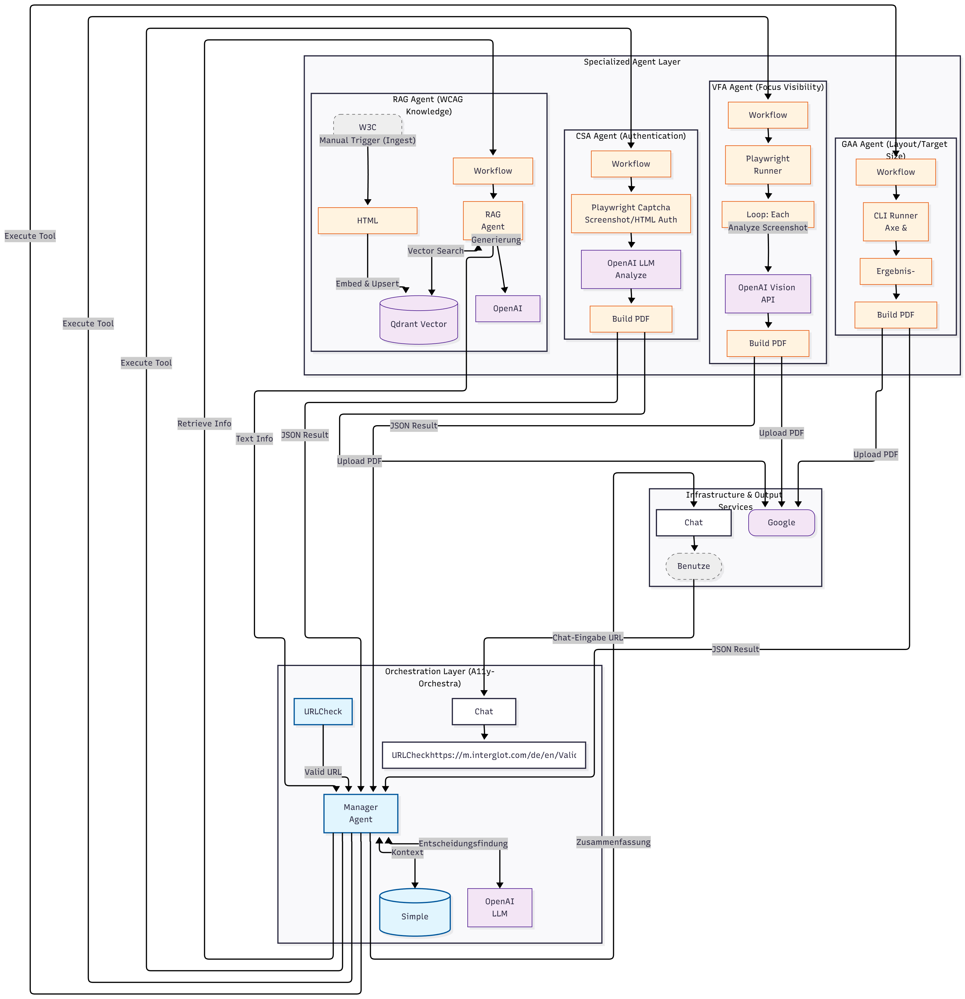

# A11y-Orchestra

Orchestriertes Multi-Agenten-System zur automatisierten Prüfung digitaler Web-Accessibility. Kombiniert regelbasierte Test-Runner (Pa11y, axe-core) mit multimodalen LLMs und RAG auf Basis von n8n, um kontextabhängige Barrieren nach WCAG 2.2 zu identifizieren.

Entwickelt als Bachelorarbeit im Studiengang Medieninformatik (HTWK Leipzig).


## Motivation

Der Ausgangspunkt war ein Webinar zur digitalen Barrierefreiheit während meiner Arbeit in einer Marketingagentur. Dort wurde der *WebAIM Million Report* vorgestellt: Über 90 % der meistbesuchten Websites weisen automatisiert erkennbare WCAG-Verstöße auf - eine Fehlerquote, die seit Jahren stagniert.

Klassische Tools wie axe-core oder Pa11y sind stark bei syntaktischer Code-Prüfung, scheitern aber systembedingt an kontextabhängigen Kriterien - z. B. ob ein Tastaturfokus-Indikator tatsächlich sichtbar ist oder ob ein CAPTCHA eine barrierefreie Alternative hat. Diese Lücken erfordern bislang aufwändige manuelle Audits.

**A11y-Orchestra** verbindet regelbasierte Prüfung mit Vision-LLMs und RAG, um genau diese semantische Lücke zu schließen - und Barrierefreiheitstests für Entwicklungsteams ohne Accessibility-Expertise zugänglich zu machen.


## Systemarchitektur

Das System folgt dem **Supervisor-Worker-Pattern** und ist in drei Ebenen aufgeteilt:



### 1. Orchestration Layer

Einstiegspunkt ist ein Chat-Interface. Der Workflow `URLCheck` bereinigt und normalisiert die Eingabe-URL (Tracking-Parameter, PII). Der `Manager-Agent` (GPT-4o, Simple Memory Buffer) koordiniert den Ablauf: Er entscheidet, welche Worker ausgeführt werden, wertet deren Ergebnisse aus und zieht bei Bedarf den RAG-Agenten hinzu.

### 2. Specialized Agent Layer

Worker-Agents sind eigenständige n8n-Sub-Workflows, die vom Manager als Tools aufgerufen werden:

- **GAA Agent (Layout/Target Size)**: Führt axe-core und Pa11y aus; GPT-4o-mini priorisiert WCAG-2.5.8-Verstöße (Target Size)
- **VFA Agent (Focus Visibility)**: Erstellt Screenshots via Playwright und prüft per Vision API, ob fokussierte Elemente durch Sticky-Header, Modals oder Overlays verdeckt sind (WCAG 2.4.11)
- **CSA Agent (Authentication)**: Scannt Login-Seiten auf kognitive Barrieren (CAPTCHAs ohne Alternative) - visuell und strukturell (WCAG 3.3.8 / 3.3.9)
- **RAG Agent (WCAG Knowledge)**: Semantische Wissensdatenbank. Ingest-Pfad: W3C WCAG-Spezifikation -> Qdrant-Vektordatenbank. Query-Pfad: semantische Suche für Behebungsvorschläge

### 3. Infrastructure & Output

- **Chat-Interface**: Steuerung und Report-Ausgabe
- **PDF-Reports**: Jeder Agent erzeugt via `pdf-lib` einen Einzel-Report (Upload zu Google Drive). Der Manager konsolidiert alles in einem Gesamtbericht


## Tech Stack

| Komponente              | Technologie                 | Version            |
| ----------------------- | --------------------------- | ------------------ |
| Orchestrierung          | n8n (Self-Hosted)           | v1.117.3           |
| Vektordatenbank         | Qdrant                      | latest             |
| LLMs                    | OpenAI GPT-4o / GPT-4o-mini | Vision & Chat APIs |
| Browser-Automatisierung | Playwright / Puppeteer-Core | v1.56.1 / v22      |
| PDF-Erstellung          | pdf-lib                     | latest             |
| Runtime                 | Node.js                     | v20 (Slim)         |

**Repo-Struktur:**

- `runner/` - JavaScript-Skripte für Playwright/Puppeteer (axe-core, pa11y, Screenshots, DOM-Extraktion)
- `workflows/` - bereinigte n8n-Workflow-JSONs zum Import
- `agent-reports/` - Beispiel-PDFs aus realen Testläufen


## Infrastruktur

Docker Compose orchestriert n8n (inkl. Playwright-Browser) und Qdrant in einem isolierten Bridge-Netzwerk. Der RAG-Ingest-Prozess läuft als eigenständiger Admin-Workflow (WCAG-Dokumente scrapen -> chunken -> Embeddings in Qdrant schreiben).

**12-Factor-Konformität (Auszug):**

- Config über `.env` (kein Hardcoding von API-Keys)
- Backing Services (Qdrant, OpenAI API) lose gekoppelt und austauschbar
- Zustandslose Prozesse; Persistenz extern
- Dev/Prod-Parität via Docker


## Evaluation

- **Mixed-Methods**: Precision und Recall gemessen an kontrollierten Testdaten und realen Sites (HTWK Leipzig, Dev.to, Slack, W3C Demos)
- **Robustheit**: Retry-Schleifen im Manager fangen fehlerhafte JSON-Antworten ab
- **Grenzfälle**: Timing-Probleme bei SPAs und Scroll-Obstruktionen durch Sticky-Header adressiert


## Setup

```bash
cp .env.example .env
# OPENAI_API_KEY in .env eintragen
docker compose up -d --build
# n8n unter http://localhost:5678 öffnen, Workflows aus workflows/ importieren
```

> API-Keys, Credential-IDs und Drive-Ordner in den Workflow-JSONs sind durch Platzhalter ersetzt.
